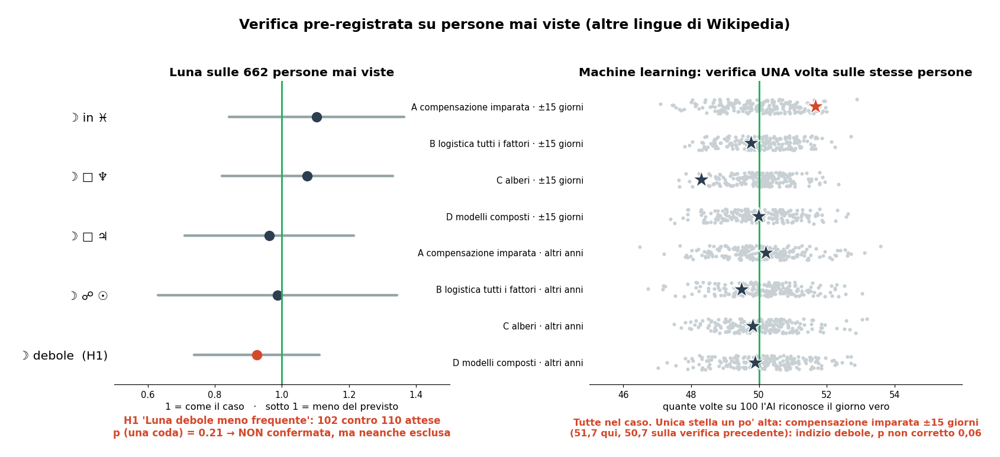

# Verifica pre-registrata su persone nuove

Scritta **prima** di guardare i dati. Persone: 692 mai usate in nessuna analisi precedente. Sono personaggi pubblici
che nelle Wikipedia in italiano, tedesco, francese, spagnolo e portoghese compaiono con "tentato suicidio" o
"antidepressivi", e che non erano già nei gruppi Wikidata né nei testi in inglese.

## Ipotesi primaria (una sola)

**H1.** La "Luna debole" (Luna in esilio o in caduta secondo `dignities.py`: Capricorno e Scorpione) è **meno
frequente** del previsto nelle persone con il problema.
Direzione decisa dal risultato esplorativo (p 0,011 in alcol e droghe, 0,048 nei suicidi), che quindi **non conta**
come conferma. Test a una coda, soglia p < 0,05.

## Ipotesi secondarie (Holm su 4)

Luna in Pesci, Luna quadrato Nettuno, Luna quadrato Giove, Luna opposta al Sole: due code.

## Metodo (identico a quello esplorativo)

- Luna con le probabilità: frazione delle 24 ore del giorno locale in cui la condizione è vera.
- Confronto: data vera contro 5 date finte della stessa persona, spostate di 1-15 giorni.
- Esclusi il 1° gennaio e le persone senza luogo di nascita.
- Statistica: (osservate − attese) / radice(attese), con attese = media delle finte.

## Machine learning (una sola verifica)

I modelli A (compensazione imparata), B, C e D di `ml_accorto.py` sono addestrati **solo** sulle persone dei gruppi
Wikidata. Si verificano **una volta** sulle 692, con 1.000 rimescolamenti, Holm su 4. Non si cambia niente dopo.

## Come si legge

Se H1 non si conferma con p < 0,05, la "Luna debole meno frequente" era rumore. Se si conferma, resta un indizio
da replicare su altri dati, perché il campione è piccolo (potenza bassa per effetti sotto il 30%).

## Risultati (02/11/2026)

**H1, Luna debole meno frequente**: 102 persone contro 110 attese (rapporto 0,93, intervallo 95% da 0,74 a 1,11).
p a una coda = 0,21. **Non confermata.** L'effetto osservato prima era circa 0,94 nei suicidi, quindi sta dentro
questo intervallo: con 662 persone il test vede solo effetti oltre il 35%, e "non confermata" non vuol dire "esclusa".
Livello: **indizio** (non confermato, non escluso).

**Ipotesi secondarie** (Luna in Pesci, quadrato a Nettuno, quadrato a Giove, opposizione al Sole): tutte dentro il caso
(p da 0,44 a 0,94).

**Machine learning** su 686 persone mai viste (verifica una sola volta): tutti gli 8 modelli dentro il caso, con Holm.
La compensazione imparata nel confronto "±15 giorni" vale 51,7 su 100 (p 0,06 non corretto). Nella verifica
precedente aveva 50,7. Unendo le due verifiche p ≈ 0,05 senza correzione per gli 8 modelli: indizio debole.
