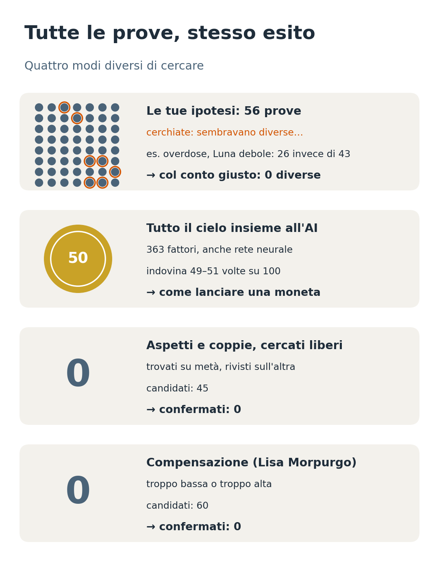
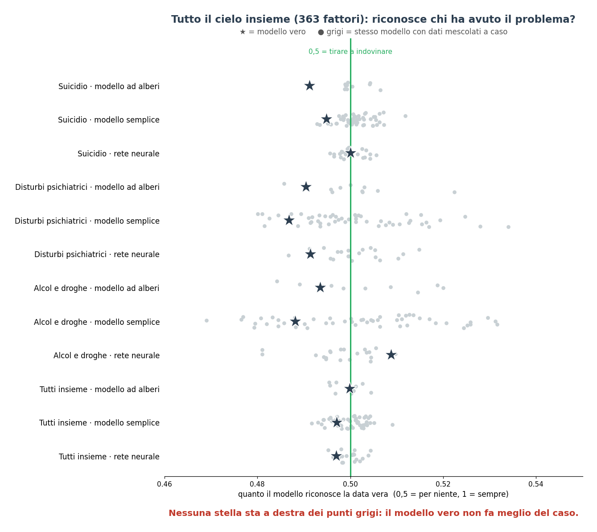
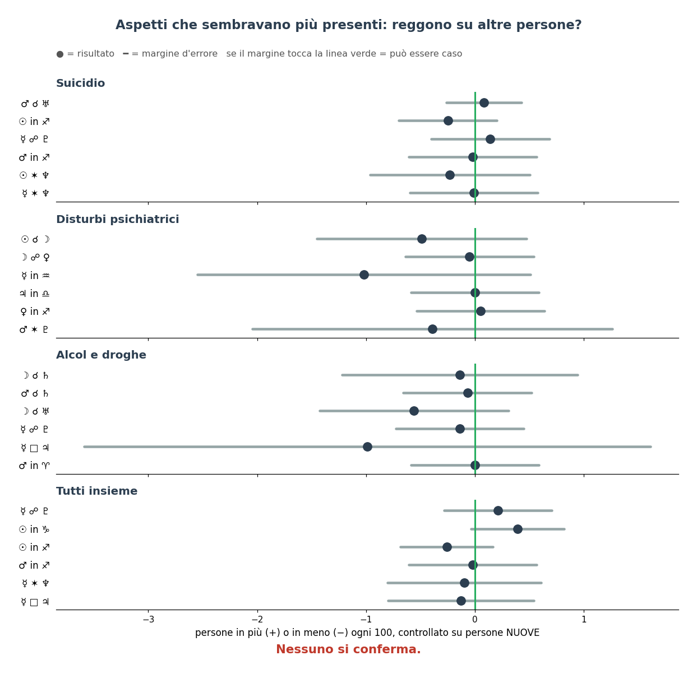
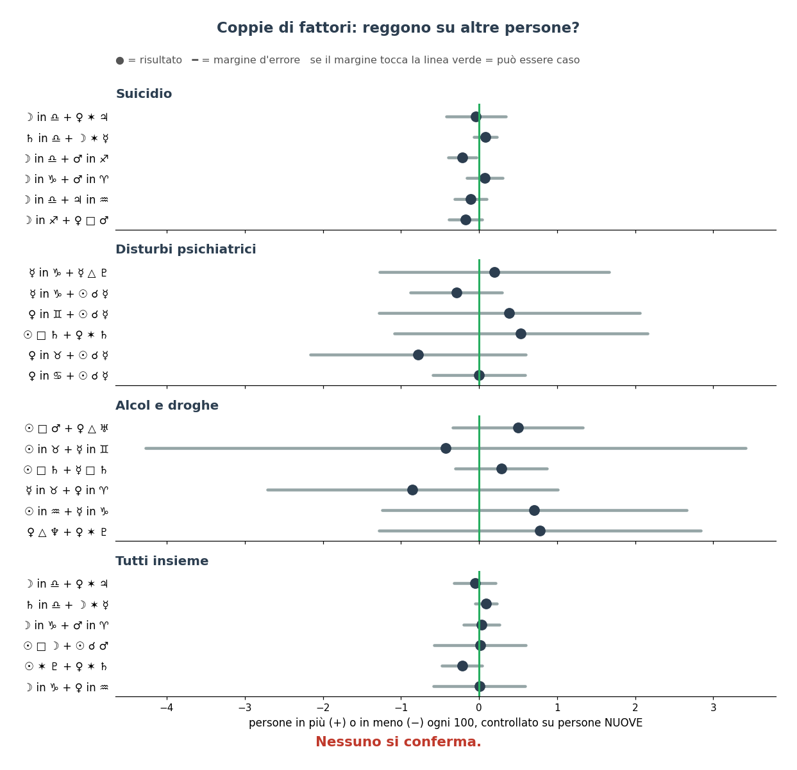
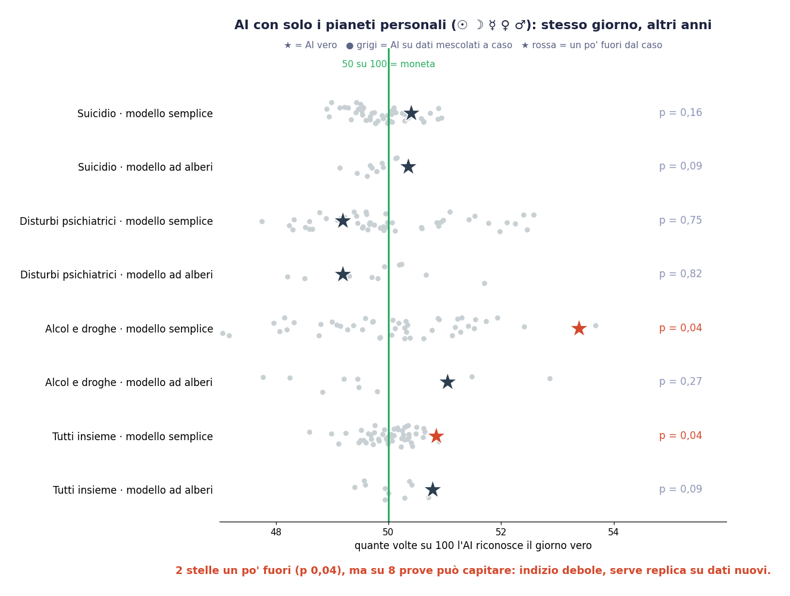

# Cielo e difficoltà: machine learning

Se l'astrologia funziona come un insieme di tanti piccoli fattori, un modello che li guarda tutti insieme dovrebbe
riconoscere il giorno di nascita vero di chi ha avuto depressione, suicidio o dipendenze.
**Risultato: indovina come una moneta.**

## Impostazione

- **Compito**: per ogni persona ci sono 6 date, quella vera e 5 finte. Il modello deve trovare quella vera.
  - confronto **giorni**: le finte sono spostate di ±1-15 giorni (si muove soprattutto la Luna);
  - confronto **anni**: stesso giorno dell'anno, ±1-5 anni, con solo i pianeti personali, perché Giove e gli altri
    pianeti lenti insegnerebbero al modello l'anno invece del cielo.
- **Fattori**: 363 in tutto: segni di tutti i pianeti, dignità, aspetti fra tutte le coppie, compensazione
  secondo Lisa Morpurgo, conteggi di quadrati, trigoni e opposizioni.
- **Modelli**: regressione logistica, alberi (gradient boosting), rete neurale su GPU, e i tre modelli combinati.
- **Compensazione imparata** (`ml_accorto.py`, modello A): i pesi non sono scelti a mano. Il modello impara un peso per
  ogni combinazione pianeta personale × aspetto × dignità dell'altro pianeta.
- **Prova del caso**: lo stesso modello su dati in cui la data "vera" è scelta a caso, da 50 a 1.000 volte.
- **Verifica**: si scopre su una metà delle persone e si controlla sull'altra. In `ml_accorto.py` si impara su ~8.000
  persone e si verifica una sola volta su ~1.900 persone nuove.
- **Coda**: si controlla anche il 2% di date più "sospette", nel caso il segnale stia in poche persone.

## Risultati

Aspetti e coppie che sembravano più presenti, verificati su altre persone:

Confronto **anni**, solo pianeti personali: due modelli sono un po' fuori dal caso (p 0,04), ma su 8 prove può
succedere. È un indizio debole, da replicare su dati nuovi.

## Lezioni da chi ci ha già provato

- Confrontare **gruppi diversi** (per esempio sportivi contro scienziati) fa uscire sempre qualcosa (55-58%), perché
  quei gruppi differiscono per epoca, ceto e stagione di nascita. Confrontando la persona con sé stessa si resta a ~50%.
- Con poche decine di temi il machine learning impara il rumore.
- Senza la prova del caso qualsiasi accuratezza sembra un successo.

## File

| File | Contenuto |
|---|---|
| `analisi/multifattore.py` | 363 fattori, modelli, prova del caso, ricerca libera su metà A e metà B |
| `analisi/coppie.py` | coppie di fattori e compensazione nelle due direzioni (test di Poisson per gli eventi rari) |
| `analisi/ml_accorto.py` | piano fissato prima, impara sulle persone vecchie e verifica su quelle nuove, compensazione imparata, modelli composti |
| `analisi/contesto_vs_cielo.py` | contesto (paese, mestiere, fama, soldi) contro cielo |
| `risultati/` | risultati in JSON |

Dipendenze: `pip install pyswisseph scikit-learn scipy numpy` (e `torch` per la rete neurale).
I dati vengono dal repo **statistiche** (`scarica_wikidata.py`).

## Verifica finale su persone nuove (`ml_accorto.py`)

Piano fissato prima di guardare: il modello impara su 8.253 persone e viene verificato **una sola volta** su 1.552
persone nuove, mai viste (dal testo di Wikipedia). Ci sono 4 modelli (compensazione imparata, tutti i fattori, alberi,
composti) per 2 confronti (giorni, anni), con la correzione di Holm sugli 8 test.

**Tutti e 8 = caso** (AUC 48,6–50,7 su 100, p corretto = 1). L'indizio del confronto "anni" non si ripete.
Pesi imparati per la compensazione: domicilio +0,03, caduta −0,03, quindi nella direzione di Morpurgo. Ma la
regolarizzazione li schiaccia verso 0 e il modello non riconosce le persone nuove: sono rumore.
